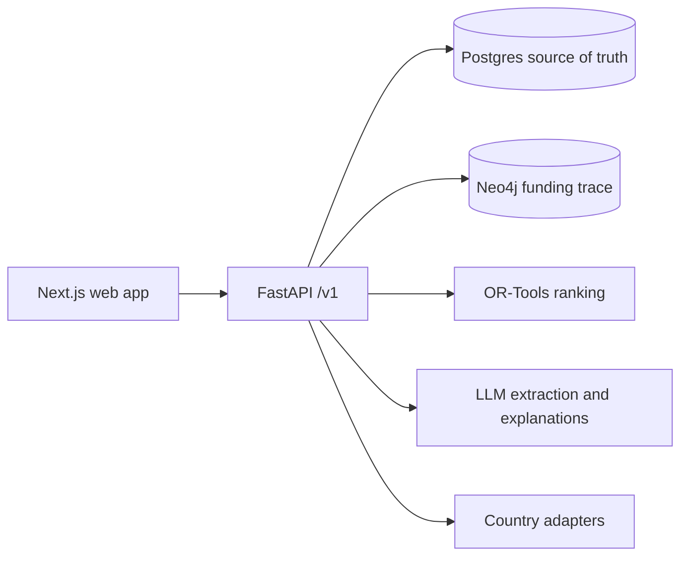

# Dawa Fire Drill

A supply chain stress-test simulator for essential medicines in Kenya, designed to support more countries. The Phase 2 backend runs synthetic shock scenarios, reports illustrative stockout sequences, and ranks assumed mitigation candidates within a budget ceiling.

**Data policy:** All project data is synthetic. Facility mix, lead-time anchors, ten tracer demand proxies and an overall funding scale use public aggregates; individual funding stages and temporal patterns remain illustrative assumptions. Model outputs are illustrative and have not been validated. Do not use them for operational decisions. See [data assumptions](docs/data-assumptions.md).

## Architecture



The backend is under development and is not deployed. The approved frontend is in progress; its national screen is currently an incomplete scaffold, not an operational application.

Phase 2b covers synthetic planning records for Kenya's 47 counties, with Kisumu as the only facility-level pilot; see [Phase 2 notes](docs/phases/2.md) for the demo evidence and limitations, including legacy country-only paths and the missing map.

Kisumu generator versions 3 and 4 include invented facility coordinates; they are not real sites or verified administrative locations. Versions 1 and 2 have no coordinates. Version 4 plants a synthetic transfer for the seed-42 first shock-caused stockout; existing snapshots remain unchanged. See [data assumptions](docs/data-assumptions.md).

## Local quickstart

Requirements: Docker with Compose. From the repository root:

```sh
docker compose -f infra/compose.yaml up -d --build
curl --fail http://localhost:8000/health
curl --fail http://localhost:8000/ready
docker compose -f infra/compose.yaml exec -T api python -m dawa_api.ingestion.persist --country KE --seed 42
docker compose -f infra/compose.yaml exec -T api python -m dawa_api.ingestion.seed_counties --seed 42
docker compose -f infra/compose.yaml down
```

The health response identifies the synthetic-data policy. API documentation is at `http://localhost:8000/docs` while the local stack runs. The local Compose database credentials are disposable development defaults; do not use them in a deployed environment.

### One-command local demo session

`bash scripts/demo-up.sh` starts a local synthetic demo session after the Compose stack is up and seeded. It refuses to run unless `APP_ENV` is unset or `local`, the compose file is this repository's `infra/compose.yaml`, and port 3300 is free. It generates a throwaway signing secret and the synthetic issuer `https://synthetic-demo.invalid`, recreates only the `api` container with demo role switching on, waits for `/ready`, mints a synthetic admin token valid for 4 hours (national planning plus Kisumu scope), raises the local per-subject rate limit to 600 requests per minute so the browser suite can share one identity, then builds the web app and starts it in production mode at `http://localhost:3300/kisumu`. The token reaches the web server only through its process environment; neither value is printed or written to a file. The web log and process ID stay in a private (`0700`) temporary directory until `bash scripts/demo-down.sh` stops the web server, deletes that directory, and recreates the `api` container with default settings (role switching off, no signing material). While a session runs, the secret is visible in the local container configuration and the token in the web process environment to the same OS user. `bash scripts/demo-up.sh -- npx playwright test` runs a local check from `apps/web` with the token in that command's environment as `E2E_DEMO_TOKEN`, which the token-leak browser test needs as its canary; the session keeps running afterwards. Requires Docker, `uv`, Node.js and `lsof`. Never use real credentials or run it against a shared or deployed environment.

For the Python test suite, install `uv`, then run `cd apps/api && uv sync --frozen --extra dev && uv run --frozen pytest -q`. Web tooling is in `apps/web`; the product frontend has not yet been implemented. The authenticated synthetic scenario demo and its prerequisites are in [Phase 2 notes](docs/phases/2.md).

See [agent rules](AGENTS.md), [current progress](docs/PROGRESS.md), [design approval gate](docs/design/APPROVAL.md), and [phase 0 notes](docs/phases/0.md). Environment templates are in `apps/api/.env.example` and `apps/web/.env.example`.
