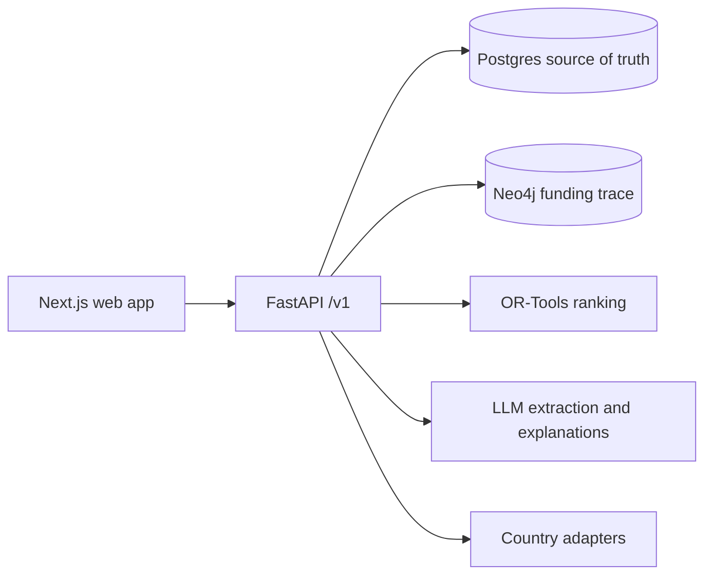
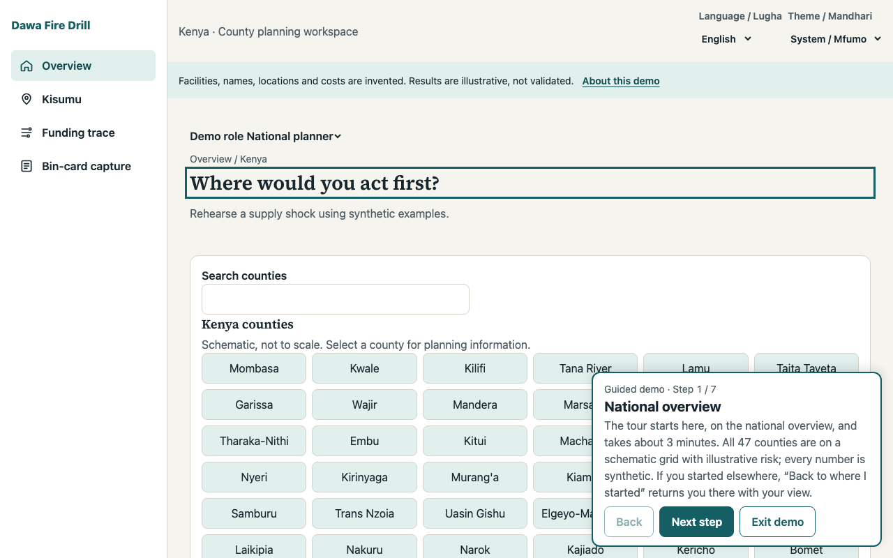
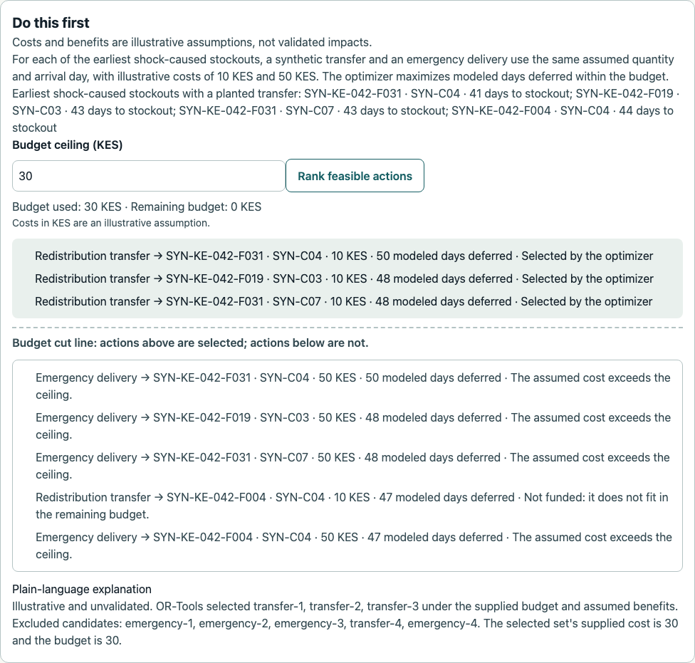
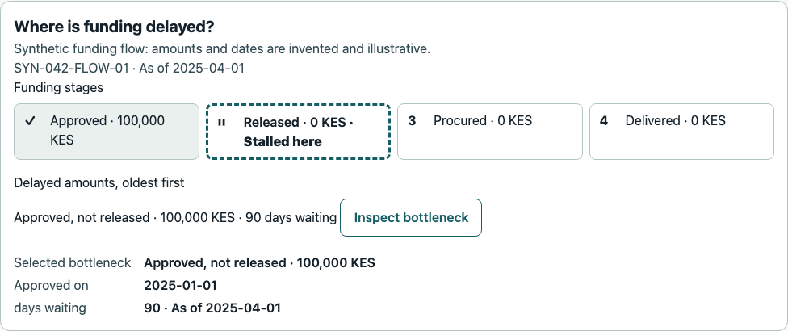
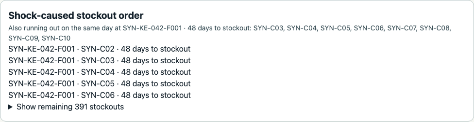
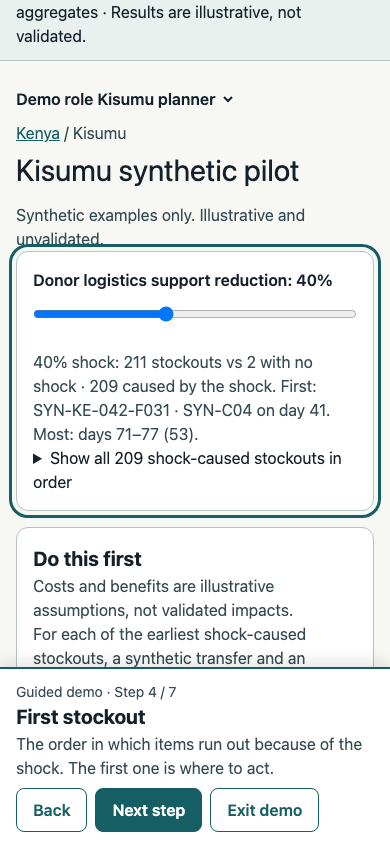
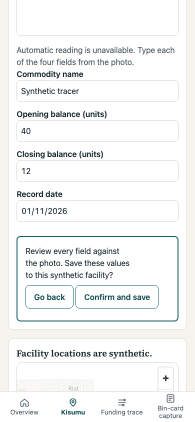

# Dawa Fire Drill

A supply chain stress-test simulator for essential medicines in Kenya, designed to support more countries. The Phase 2 backend runs synthetic shock scenarios, reports illustrative stockout sequences, and ranks assumed mitigation candidates within a budget ceiling.

**Data policy:** All project data is synthetic. Facility mix, lead-time anchors, ten tracer demand proxies and an overall funding scale use public aggregates; individual funding stages and temporal patterns remain illustrative assumptions. Model outputs are illustrative and have not been validated. Do not use them for operational decisions. See [data assumptions](docs/data-assumptions.md).

## Architecture



Nothing is deployed. The approved frontend is in progress (Phase 3, before Checkpoint C): the national overview, Kisumu pilot, ranked fixes, a funding-trace slice, bin-card capture and a guided demo run locally against the backend. See [limitations](#limitations).

Phase 2b covers synthetic planning records for Kenya's 47 counties, with Kisumu as the only facility-level pilot; see [Phase 2 notes](docs/phases/2.md) for the demo evidence and limitations, including legacy country-only paths and the missing map.

Kisumu generator versions 3 and 4 include invented facility coordinates; they are not real sites or verified administrative locations. Versions 1 and 2 have no coordinates. Version 4 plants a synthetic transfer for the seed-42 first shock-caused stockout; existing snapshots remain unchanged. See [data assumptions](docs/data-assumptions.md). Version 5, now served by default, varies opening cover per facility and commodity so shock-caused stockouts spread over several weeks, and replants the transfer for the new first event.

## Screenshots

All screens show synthetic data; every number is illustrative and unvalidated.

| | |
| --- | --- |
|  |  |
| National overview with the guided demo (1280 px) | Ranked fix for the first shock-caused stockout |
|  |  |
| Funding trace: 100,000 KES approved, not released, 90 days | Shock-caused stockout order at 40% |
|  |  |
| Guided demo at 390 px | Bin-card capture: nothing is saved until “Confirm and save” |

## Local quickstart

Requirements: Docker with Compose, [`uv`](https://docs.astral.sh/uv/), Node.js with npm, and `lsof`. From the repository root:

```sh
docker compose -f infra/compose.yaml up -d --build
curl --fail http://localhost:8000/health
curl --fail http://localhost:8000/ready
docker compose -f infra/compose.yaml exec -T api python -m dawa_api.ingestion.persist --country KE --seed 42
docker compose -f infra/compose.yaml exec -T api python -m dawa_api.ingestion.seed_counties --seed 42
(cd apps/web && npm ci)
bash scripts/demo-up.sh
```

Open `http://localhost:3300/` and choose **Try the 3-minute demo**. When you are done:

```sh
bash scripts/demo-down.sh
docker compose -f infra/compose.yaml down
```

The health response identifies the synthetic-data policy. API documentation is at `http://localhost:8000/docs` while the local stack runs. The local Compose database credentials are disposable development defaults; do not use them in a deployed environment.

### What the demo scripts do

`bash scripts/demo-up.sh` starts a local synthetic demo session after the Compose stack is up and seeded. It refuses to run unless `APP_ENV` is unset or `local`, the compose file is this repository's `infra/compose.yaml`, and port 3300 is free. It generates a throwaway signing secret and the synthetic issuer `https://synthetic-demo.invalid`, recreates only the `api` container with demo role switching on, waits for `/ready`, mints a synthetic admin token valid for 4 hours (national planning plus Kisumu scope), raises the local per-subject rate limit to 600 requests per minute so the browser suite can share one identity, then builds the web app and starts it in production mode at `http://localhost:3300/kisumu`. The token reaches the web server only through its process environment; neither value is printed or written to a file. The web log and process ID stay in a private (`0700`) temporary directory until `bash scripts/demo-down.sh` stops the web server, deletes that directory, and recreates the `api` container with default settings (role switching off, no signing material). While a session runs, the secret is visible in the local container configuration and the token in the web process environment to the same OS user. `bash scripts/demo-up.sh -- npx playwright test` runs a local check from `apps/web` with the token in that command's environment as `E2E_DEMO_TOKEN`, which the token-leak browser test needs as its canary; the session keeps running afterwards. Requires Docker, `uv`, Node.js and `lsof`. Never use real credentials or run it against a shared or deployed environment.

## Three-minute demo script

Start at `http://localhost:3300/` and press **Try the 3-minute demo**. Each step has a caption, **Back**, **Next step** and **Exit demo**; Escape also exits. The demo only navigates, applies the 40% shock, presses Rank once and switches to the facility role for capture; everything shown comes from the normal screens.

1. **National overview (≈20 s).** “Forty-seven counties on a schematic grid, not a map. Every value is synthetic and illustrative.”
2. **Kisumu pilot (≈20 s).** “Kisumu is the only facility-level pilot: forty invented facilities at invented locations. Risk uses shape and text, not only color.”
3. **Apply a 40% shock (≈20 s).** “Donor logistics support drops by 40% and the county model reruns.”
4. **First stockout (≈30 s).** “The shock-caused order. SYN-KE-042-F031 runs out of SYN-C04 first, on day 41; the rest follow over the next seven weeks. Act here first.”
5. **Funding trace (≈30 s).** “One synthetic flow: 100,000 KES approved but not released, waiting 90 days.”
6. **Ranked fix (≈40 s).** “OR-Tools compares a 10 KES transfer with a 50 KES emergency delivery under a 100 KES ceiling. It selects the transfer; the emergency delivery sits below the cut line. Costs are assumptions, and the explanation only restates the optimizer's result.”
7. **Bin-card capture (≈20 s).** “The facility in-charge uploads a synthetic bin-card photo. With no extraction provider configured locally, they type each value from the photo and must confirm before anything is saved.”

Press **Finish demo**. To show a different budget, change “Budget ceiling (KES)”: at 10–49 KES the transfer stays selected and the emergency delivery is excluded because its assumed cost exceeds the ceiling; below 10 KES the screen says no supplied option fits.

For the Python test suite, install `uv`, then run `cd apps/api && uv sync --frozen --extra dev && uv run --frozen pytest -q`. Web checks run from `apps/web`: `npm run lint`, `npm run typecheck`, `npx vitest run`; browser tests need a running demo session (`bash scripts/demo-up.sh -- npx playwright test`). The authenticated synthetic scenario demo and its prerequisites are in [Phase 2 notes](docs/phases/2.md).

See [agent rules](AGENTS.md), [current progress](docs/PROGRESS.md), [design approval gate](docs/design/APPROVAL.md), and [phase 0 notes](docs/phases/0.md). Environment templates are in `apps/api/.env.example` and `apps/web/.env.example`.

## Limitations

- **Synthetic and unvalidated.** All data is invented or calibrated only to public aggregates; forecasts, stockout days, deferrals and rankings are illustrative and have not been validated against real outcomes. Do not use them for operational decisions.
- **Not a geographic map of counties.** The national view is a schematic 47-county grid because boundary data rights are unresolved. Kisumu facility locations are invented.
- **Narrow ranking.** The ranked fix compares two planted candidates for the first shock-caused stockout with assumed costs (10 and 50 KES) and assumed benefits. Automatic candidate generation is not built.
- **Funding trace is a slice.** One planted stalled-release flow with stage amounts and ageing. The partial-graph state, filters, stage diagram and a dedicated Funding page are not built.
- **Capture is online only and unreviewed for extraction quality.** There is no offline queue. The local stack has no extraction provider, so fields are typed by hand; no real LLM provider has been exercised end to end.
- **Language.** Swahili strings, and the English-only optimizer explanation, need native-speaker review.
- **No production sign-in.** The demo uses a server-side proxy with a privileged synthetic token, allowed only in local or staging environments behind external access control.
- **Performance and design gaps.** The interactive Lighthouse flow meets its performance budget, but layout shift in that flow (0.006–0.203 across runs) is not resolved, and it is not in CI. Bottom navigation, several design states and screenshot review against the approved design are outstanding. See [progress](docs/PROGRESS.md) and [Phase 3 notes](docs/phases/3.md).
