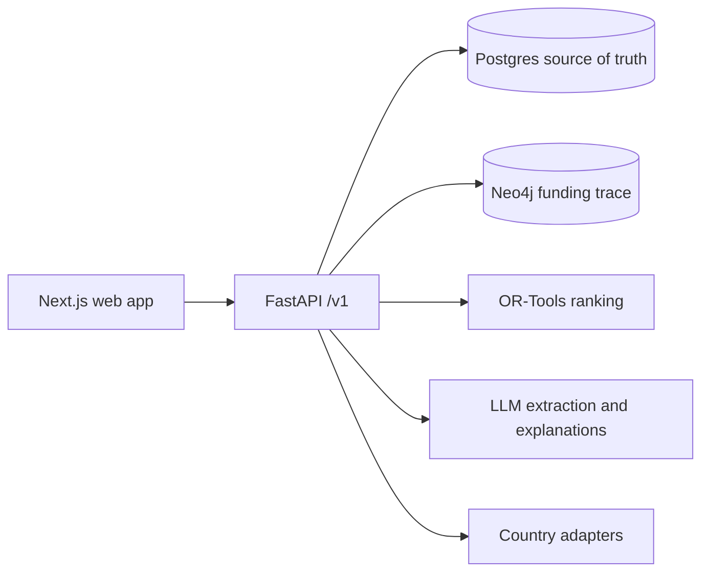

# Dawa Fire Drill

A supply chain stress-test simulator for essential medicines in Kenya, designed to support more countries. The Phase 2 backend runs synthetic shock scenarios, reports illustrative stockout sequences, and ranks assumed mitigation candidates within a budget ceiling.

**Data policy:** All project data is synthetic. Facility-level mix, lead-time anchors and ten tracer demand proxies are guided by public aggregates; funding values and temporal patterns remain illustrative assumptions. Model outputs are illustrative and have not been validated. Do not use them for operational decisions. See [data assumptions](docs/data-assumptions.md).

## Architecture



The backend is under development and is not deployed. The design was approved; frontend implementation remains for a later phase.

## Local quickstart

Requirements: Docker with Compose. From the repository root:

```sh
docker compose -f infra/compose.yaml up -d --build
curl --fail http://localhost:8000/health
curl --fail http://localhost:8000/ready
docker compose -f infra/compose.yaml exec -T api python -m dawa_api.ingestion.persist --country KE --seed 42
docker compose -f infra/compose.yaml down
```

The health response identifies the synthetic-data policy. API documentation is at `http://localhost:8000/docs` while the local stack runs. The local Compose database credentials are disposable development defaults; do not use them in a deployed environment.

For the Python test suite, install `uv`, then run `cd apps/api && uv sync --frozen --extra dev && uv run --frozen pytest -q`. Web tooling is in `apps/web`; the product frontend has not yet been implemented. The authenticated synthetic scenario demo and its prerequisites are in [Phase 2 notes](docs/phases/2.md).

See [agent rules](AGENTS.md), [current progress](docs/PROGRESS.md), [design approval gate](docs/design/APPROVAL.md), and [phase 0 notes](docs/phases/0.md). Environment templates are in `apps/api/.env.example` and `apps/web/.env.example`.
