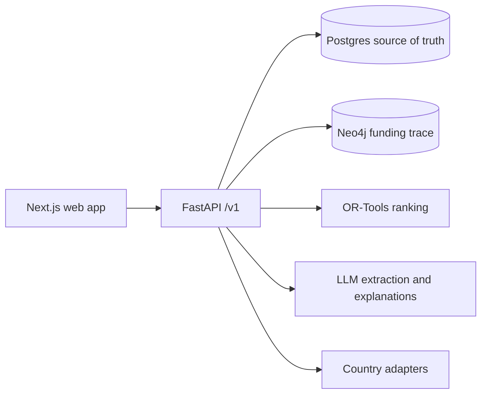
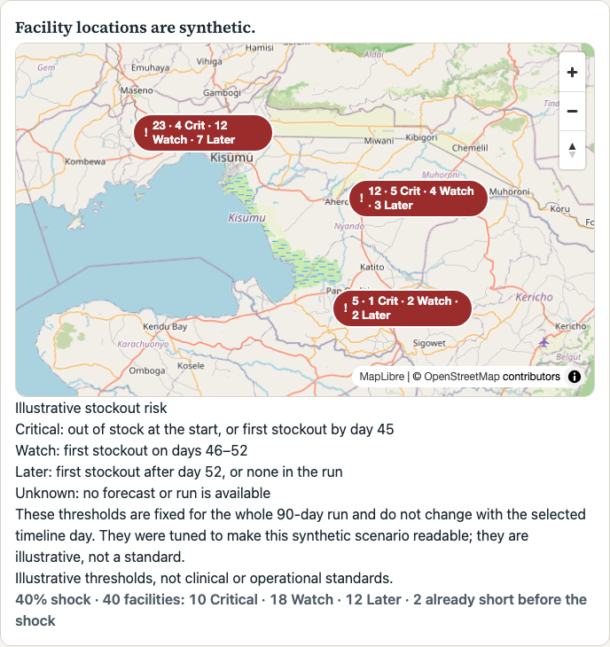
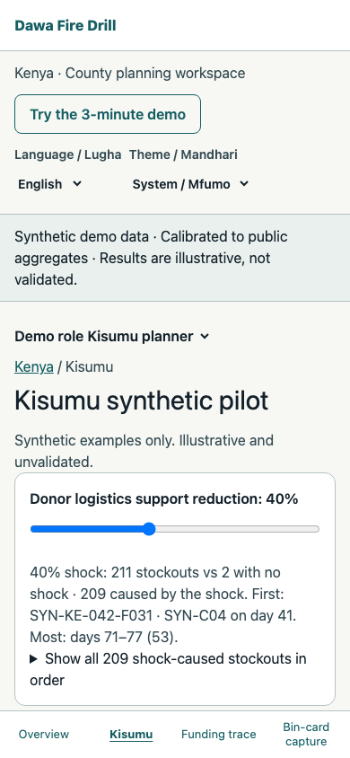

# Dawa Fire Drill

A supply chain stress-test simulator for essential medicines in Kenya, designed to support more countries. The Phase 2 backend runs synthetic shock scenarios, reports illustrative stockout sequences, and ranks assumed mitigation candidates within a budget ceiling.

**Data policy:** All project data is synthetic. Facility mix, lead-time anchors, ten tracer demand proxies and an overall funding scale use public aggregates; individual funding stages and temporal patterns remain illustrative assumptions. Model outputs are illustrative and have not been validated. Do not use them for operational decisions. See [data assumptions](docs/data-assumptions.md).

## Architecture



Nothing is deployed. The approved frontend is in progress (Phase 3, before Checkpoint C): the national overview, Kisumu pilot, ranked fixes, a funding-trace slice, bin-card capture and a guided demo run locally against the backend. See [limitations](#limitations).

Phase 2b covers synthetic planning records for Kenya's 47 counties, with Kisumu as the only facility-level pilot; see [Phase 2 notes](docs/phases/2.md) for the demo evidence and limitations, including legacy country-only paths and the missing map.

Kisumu generator versions 3 and 4 include invented facility coordinates; they are not real sites or verified administrative locations. Versions 1 and 2 have no coordinates. Version 4 plants a synthetic transfer for the seed-42 first shock-caused stockout; existing snapshots remain unchanged. See [data assumptions](docs/data-assumptions.md). Version 5, now served by default, varies opening cover per facility and commodity so shock-caused stockouts spread over several weeks, keeps every invented location on land, and replants the transfer for the new first event.

## Screenshots

All screens show synthetic data; every number is illustrative and unvalidated.

| | |
| --- | --- |
|  |  |
| National overview with the guided demo (1280 px) | Ranked fixes at 30 units: three transfers funded, the fourth cut by the remaining budget |
|  |  |
| Funding trace: stage bar stalled at Released; 100,000 KES approved, not released, 90 days | Shock summary at 40%: first stockout and busiest week |
|  |  |
| Facility map at 40%: each cluster shows its status mix; the counts line gives 10 Critical, 18 Watch, 12 Stable | Kisumu at 390 px with the bottom navigation bar |
|  |  |
| Guided demo at 390 px, above the bottom bar | Bin-card capture: nothing is saved until “Confirm and save” |

## Local quickstart

Requirements: Docker with Compose, [`uv`](https://docs.astral.sh/uv/), Node.js with npm, and `lsof`. From the repository root:

```sh
docker compose -f infra/compose.yaml up -d --build
curl --fail http://localhost:8000/health
curl --fail http://localhost:8000/ready
docker compose -f infra/compose.yaml exec -T api python -m dawa_api.ingestion.persist --country KE --seed 42
docker compose -f infra/compose.yaml exec -T api python -m dawa_api.ingestion.seed_counties --seed 42
(cd apps/web && npm ci)
bash scripts/demo-up.sh
```

Open `http://localhost:3300/` and choose **Try the 3-minute demo**. Run the demo with `bash scripts/demo-up.sh`, not `npm run dev`: in development mode React mounts components twice, which can stall the guided demo's automatic rank on “Ranking feasible actions…”. When you are done:

```sh
bash scripts/demo-down.sh
docker compose -f infra/compose.yaml down
```

The health response identifies the synthetic-data policy. API documentation is at `http://localhost:8000/docs` while the local stack runs. The local Compose database credentials are disposable development defaults; do not use them in a deployed environment.

### What the demo scripts do

`bash scripts/demo-up.sh` starts a local synthetic demo session after the Compose stack is up and seeded. It refuses to run unless `APP_ENV` is unset or `local`, the compose file is this repository's `infra/compose.yaml`, and port 3300 is free. It generates a throwaway signing secret and the synthetic issuer `https://synthetic-demo.invalid`, recreates only the `api` container with demo role switching on, waits for `/ready`, mints a synthetic admin token valid for 4 hours (national planning plus Kisumu scope), raises the local per-subject rate limit to 1,200 requests per minute so the browser suite can share one identity, then builds the web app and starts it in production mode at `http://localhost:3300/kisumu`. The token reaches the web server only through its process environment; neither value is printed or written to a file. The web log and process ID stay in a private (`0700`) temporary directory until `bash scripts/demo-down.sh` stops the web server, deletes that directory, and recreates the `api` container with default settings (role switching off, no signing material). While a session runs, the secret is visible in the local container configuration and the token in the web process environment to the same OS user. `bash scripts/demo-up.sh -- npx playwright test` runs a local check from `apps/web` with the token in that command's environment as `E2E_DEMO_TOKEN`, which the token-leak browser test needs as its canary; the session keeps running afterwards. Requires Docker, `uv`, Node.js and `lsof`. Never use real credentials or run it against a shared or deployed environment.

## Three-minute demo script

Start at `http://localhost:3300/` and press **Try the 3-minute demo**. Each step has a caption, **Back**, **Next step** and **Exit demo**; Escape also exits. The demo only navigates, opens the tab each step needs and switches to the facility role for capture; everything shown comes from the normal screens.

1. **National overview (≈20 s).** “Forty-seven counties on a schematic grid, not a map. Every value is synthetic and illustrative.”
2. **Kisumu pilot (≈20 s).** “Kisumu is the only facility-level pilot: forty invented facilities with invented names at invented locations. The page answers first: what breaks, how far the fixes reach, and the cheapest fix within the budget.”
3. **Apply a 40% shock (≈20 s).** “Four prepared scenarios; at a 40% cut in donor logistics support, 10 facilities are Critical, 18 Watch and 12 Stable. Compare flips to the no-shock run, where only the two facilities already short before the shock are Critical.”
4. **First stockout (≈30 s).** “The verdict: 209 stockouts caused by the shock; Tamarind Crossing Sub-County Hospital (Kisumu West) runs out of family planning tracer 04 first, on day 41. The fixes address only the 4 earliest of those 209. ‘209 stockouts’ opens the full order; the timeline under Where it breaks plays the run week by week.”
5. **Funding trace (≈30 s).** “One synthetic flow: the stage bar shows money approved but stalled before release; 100,000 KES has waited 90 days.”
6. **Ranked fix (≈40 s).** “For each of the four earliest shock-caused stockouts, OR-Tools compares a 10-unit transfer from a nearby facility with a 50-unit emergency delivery, maximizing modeled days deferred within a 30-unit budget (illustrative cost units, not prices). It funds three transfers; the fourth sits below the cut line because it no longer fits the remaining budget, and every emergency delivery costs more than the budget. The budget slider re-ranks live. Costs are assumptions, and ‘Why these picks?’ only restates the optimizer's result.”
7. **Bin-card capture (≈20 s).** “The facility in-charge uploads a synthetic bin-card photo. With no extraction provider configured locally, the fields come back empty, focus moves to the first one, and they type all four values from the photo. Nothing is saved until they confirm.”

Press **Finish demo**. To show a different budget, move “Budget (illustrative units)”: at 100 units all four transfers are funded and each emergency delivery is excluded because a cheaper option covers the same stockout; at 5 units nothing fits and every action is excluded as over the ceiling.

For the Python test suite, install `uv`, then run `cd apps/api && uv sync --frozen --extra dev && uv run --frozen pytest -q`. Web checks run from `apps/web`: `npm run lint`, `npm run typecheck`, `npx vitest run`; browser tests need a running demo session (`bash scripts/demo-up.sh -- npx playwright test`). The authenticated synthetic scenario demo and its prerequisites are in [Phase 2 notes](docs/phases/2.md).

See [agent rules](AGENTS.md), [current progress](docs/PROGRESS.md), [design approval gate](docs/design/APPROVAL.md), and [phase 0 notes](docs/phases/0.md). Environment templates are in `apps/api/.env.example` and `apps/web/.env.example`.

## Limitations

- **Synthetic and unvalidated.** All data is invented or calibrated only to public aggregates; forecasts, stockout days, deferrals and rankings are illustrative and have not been validated against real outcomes. Do not use them for operational decisions.
- **Not a geographic map of counties.** The national view is a schematic 47-county grid because boundary data rights are unresolved. Kisumu facility locations are invented.
- **Narrow ranking.** The ranked fix compares planted candidates for the four earliest shock-caused stockouts: one synthetic transfer and one emergency delivery each, with assumed costs (10 and 50 illustrative units) and the same assumed quantity and arrival day. Candidates are not generated for other stockouts or other kinds of action.
- **Funding trace is a slice.** One planted stalled-release flow with a four-step stage bar, amounts and ageing. The partial-graph state, filters and a dedicated Funding page are not built.
- **Capture is online only and unreviewed for extraction quality.** There is no offline queue. The local stack has no extraction provider, so fields are typed by hand when extraction returns empty or partial values. If the upload itself fails, no capture record exists and manual entry cannot be offered; the user must retake or retry the photo. No real LLM provider has been exercised end to end.
- **Language.** Swahili strings, and the English-only optimizer explanation, need native-speaker review.
- **No production sign-in.** The demo uses a server-side proxy with a privileged synthetic token, allowed only in local or staging environments behind external access control.
- **Risk cutoffs are tuned, not a standard.** Map labels use Critical within 45 days, Watch 46–52 and Stable beyond 52. These cutoffs were tuned to make this synthetic scenario readable, are relative to the 90-day simulation horizon, and are not a standard. A facility takes the status of its worst commodity.
- **Map clusters show a mix of statuses.** The invented facilities sit in clusters of five or six within about 300 m of each other, so at county zoom their markers would stack. The map therefore groups them into one cluster labeled with its size and status mix (for example “6 · 2 Crit · 2 Watch · 2 Stable”) and the worst-status symbol. Groups merge until no two labels overlap, so on a phone most of the county is one cluster; Enter or a click zooms in step by step until facilities separate. The counts line under the legend always gives the full split.
- **Four mobile destinations, not five.** The phone bottom bar links Overview, Kisumu, Funding trace and Bin-card capture. The approved design's five destinations include Scenarios, Actions and Stock, which are not built yet.
- **Kisumu page-load performance is below budget.** Lighthouse page load scores 1.00 on `/` but 0.73–0.74 on `/kisumu` (accessibility and best practices 1.00, layout shift 0, total blocking time about 150 ms), under the 0.80 budget. The cause is Largest Contentful Paint (about 9.9 s under Lighthouse's simulated throttling; about 2 s in an unthrottled browser): the page's largest text is the data-driven verdict, which can only appear once the backend scenario run completes (session, pilot panel, run submission and polling, in sequence). The page shows the title and the framing question at full size immediately and reserves the verdict's space, but the browser still counts the verdict text as the largest paint when it replaces the framing. Faster runs need backend changes (for example reusing a completed run for the same inputs), which were out of scope for the redesign. Interactive use is not affected: moving the budget and the timeline scores 1.00 with layout shift 0.000. The flow is not in CI. See [progress](docs/PROGRESS.md) and [Phase 3 notes](docs/phases/3.md).

## Next steps

- Risk from the share of commodities at risk, with per-commodity thresholds from real lead times.
