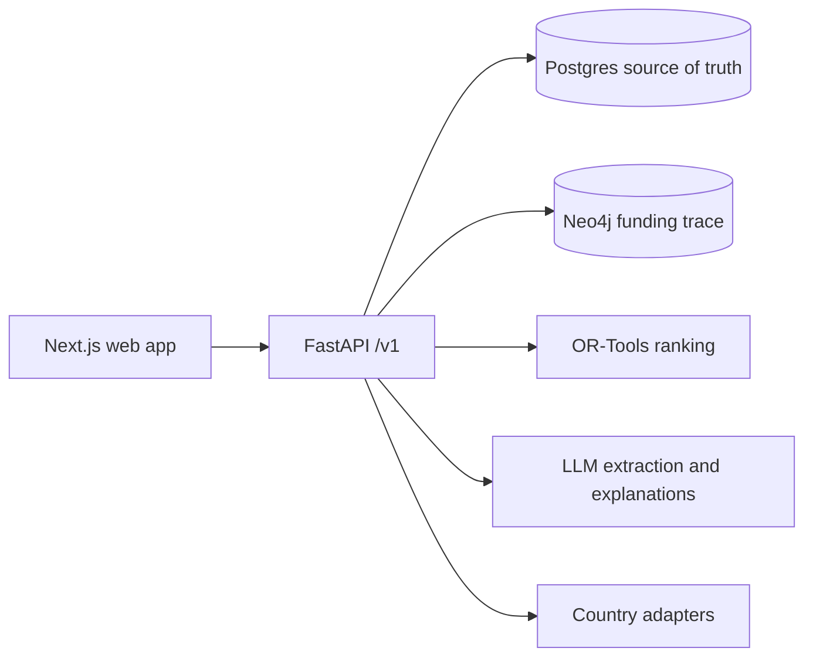

# Dawa Fire Drill

A planned supply chain stress-test simulator for essential medicines in Kenya, designed to support more countries. Planners will explore shock scenarios, stockout sequences, and mitigations within a budget ceiling.

**Data policy:** All project data is synthetic and calibrated to public aggregates. Model outputs are illustrative and have not been validated. Do not use them for operational decisions.

## Planned architecture



This is a target architecture, not a deployed system. Frontend implementation awaits design approval.

## Phase 0 quickstart

Requirements: Docker with Compose. From the repository root:

```sh
docker compose -f infra/compose.yaml up -d --build
curl --fail http://localhost:8000/health
docker compose -f infra/compose.yaml down
```

The health response identifies the synthetic-data policy. API documentation is at `http://localhost:8000/docs` while the local stack runs. The local Compose database credentials are disposable development defaults; do not use them in a deployed environment.

For the Python test suite, install `uv`, then run `cd apps/api && uv sync --frozen --extra dev && uv run --frozen pytest -q`. Web tooling is in `apps/web`; no frontend product code exists before design approval.

See [agent rules](AGENTS.md), [current progress](docs/PROGRESS.md), [design approval gate](docs/design/APPROVAL.md), and [phase 0 notes](docs/phases/0.md). Environment templates are in `apps/api/.env.example` and `apps/web/.env.example`.
