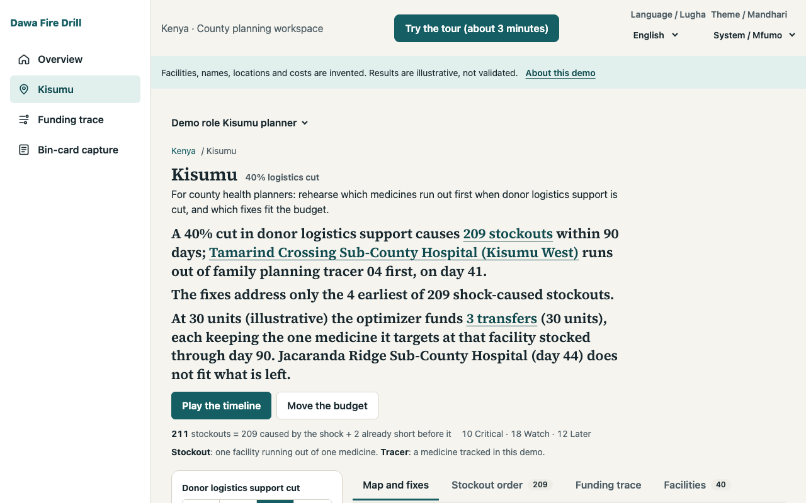
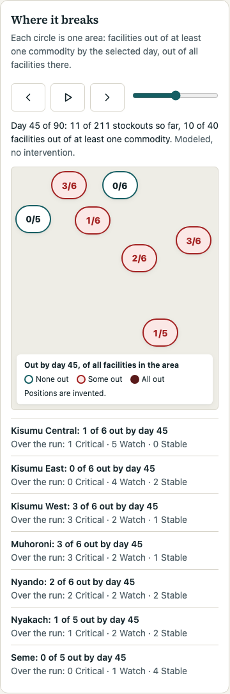
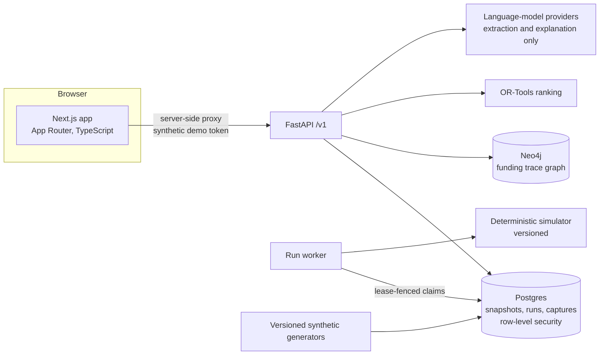

# Dawa Fire Drill

A stress-test sandbox for essential-medicine supply in Kenya: pick a shock, see what runs out first, and get the cheapest fix that fits a budget.



**Every number in this project is synthetic.** Facilities, names, coordinates, stock levels and costs are invented. Only some scale parameters (facility mix, lead times, demand and funding totals) are anchored to public aggregates, documented in [data assumptions](docs/data-assumptions.md). No model output has been validated. Do not use it for operational decisions.

## The problem

When donor logistics support or a cash release is cut, county health planners need to know three things quickly: which facilities and medicines run out first, why, and what the cheapest response is with the money they have. That reasoning usually happens in spreadsheets, after the stockouts have started. Dawa Fire Drill is a place to rehearse it in advance on a realistic but invented county, with the reasoning visible.

## What it does

The three-minute guided demo walks through the same screens a planner uses. The figures below are what the app shows for seed 42 and county generator version 5.

1. **National overview.** Kenya's 47 counties on a schematic grid (deliberately not a boundary map) with synthetic planning proxies. Kisumu is the facility-level pilot.
2. **Pick a shock.** Four prepared scenarios cut donor logistics support by 0, 20, 40 or 100%. At 40%, the verdict reads: *“A 40% cut in donor logistics support causes 209 stockouts within 90 days; Tamarind Crossing Sub-County Hospital (Kisumu West) runs out of family planning tracer 04 first, on day 41.”* 211 stockouts happen in total; 2 are at facilities already short before the shock, and the app keeps them apart. Facilities split 10 Critical, 18 Watch and 12 Stable. “Compare” flips to the no-shock run.
3. **Watch it break.** A day scrubber (week steps, play, keyboard) shows facilities out per area across the 90-day run. At day 41 the run has 3 stockouts across 3 facilities; at day 90, 211 across all 40.
4. **Cheapest fix within a budget.** OR-Tools compares a transfer from a nearby facility (10 illustrative cost units) with an emergency delivery (50 units) for each covered stockout. The page says plainly that the options cover only the 4 earliest of the 209 shock-caused stockouts. At 30 units the optimizer funds 3 transfers and cuts the fourth (Jacaranda Ridge Sub-County Hospital, day 44) because it no longer fits; at 100 units it funds all 4 for 40 units; at 5 units nothing fits. The budget slider re-ranks live, and “Why these picks?” restates the optimizer's own result.
5. **Where the money stalls.** One synthetic funding flow shows 100,000 KES approved but not released after 90 days, with the stalled stage marked.
6. **Honest edges.** At 100% no listed transfer can arrive in time: they arrive from day 39, but their stockouts happen by day 26, and the page says so instead of showing an empty list. Loading, in-flight, failed and offline states are all explicit.
7. **Bin-card capture.** A facility in-charge uploads a bin-card photo; extracted fields (typed by hand when no provider is configured) are saved only after the person confirms every one.

English and Swahili, light and dark themes, a guided demo with keyboard support, and a link that recreates the view (shock, budget, tab and day are in the URL).

| | |
| --- | --- |
|  |  |
| Cheapest fixes at 30 units | Where it breaks at day 45 (positions invented) |
|  |  |
| Funding trace: approved, not released | Facility map at 40% (OpenStreetMap tiles) |
|  |  |
| Kisumu at 390 px | Capture: nothing is saved until confirmed |

## Architecture



The web app never holds a token in the browser: a server-side route proxies to the API with a short-lived synthetic token minted by `scripts/demo-up.sh`. Scenario runs are queued in Postgres and processed by a worker against a pinned data snapshot and simulator version. Rankings come from OR-Tools; explanations only restate them.

## Key design decisions

Short records live in [`docs/adr/`](docs/adr/).

- **Synthetic data with versioned generators** ([ADR 0001](docs/adr/0001-synthetic-data-versioned-generators.md)). No real facility data is used. Generators are versioned (county generator v1–v5) and seeded, and stored snapshots never change, so every run is reproducible and older results stay explainable. Tradeoff: nothing here says anything about real outcomes.
- **The optimizer decides; AI only explains** ([ADR 0002](docs/adr/0002-optimizer-decides-ai-explains.md)). OR-Tools selects the funded set; language models may only extract bin-card fields or restate the optimizer's result, and their output never changes a ranking. Tradeoff: explanations are plain and English-only rather than persuasive.
- **Row-level tenancy** ([ADR 0003](docs/adr/0003-row-level-tenancy.md)). Postgres row-level security scopes scenario rows to the country in a transaction-local setting taken from the signed token, never from a header or payload. Tradeoff: the app must run as a non-superuser role, and some legacy paths are still country-scoped only.
- **Deterministic, versioned simulation** ([ADR 0004](docs/adr/0004-deterministic-versioned-simulation.md)) and **a Postgres-backed queue** ([ADR 0005](docs/adr/0005-postgres-backed-queue.md)) with lease tokens instead of a separate broker.
- **A language-model provider abstraction** ([ADR 0006](docs/adr/0006-llm-provider-abstraction.md)) with mocked providers in CI and a manual fallback when no provider is configured.
- **Illustrative cost units** ([ADR 0007](docs/adr/0007-illustrative-cost-units.md)): fix costs are “units”, not shillings, because they are not calibrated to real prices; the funding trace keeps KES.
- **Honest edge states.** The UI says when fixes cover only some stockouts, when nothing fits, when no transfer can arrive in time, and which facilities were already short before the shock.

## Tech stack

- **Frontend:** Next.js 16 (App Router), React 19, strict TypeScript, Tailwind CSS 4 with CSS-variable tokens, MapLibre GL with OpenStreetMap tiles, a self-hosted Source Serif 4 display face.
- **Backend:** Python 3.12, FastAPI, Pydantic v2, SQLAlchemy 2 (async), Alembic, Postgres 16 with row-level security, Neo4j 5, OR-Tools, pandas and statsmodels.
- **Tooling:** Vitest and Testing Library, Playwright with axe, Lighthouse CI, pytest with Hypothesis and Schemathesis, Ruff, mypy, ESLint, Prettier, gitleaks, pip-audit, npm audit, Bandit, Docker Compose, GitHub Actions.

## Quickstart

Requirements: Docker with Compose, [`uv`](https://docs.astral.sh/uv/), Node.js 24 with npm, and `lsof`. From a fresh clone:

```sh
docker compose -f infra/compose.yaml up -d --build
curl --fail --retry 20 --retry-delay 3 --retry-all-errors http://localhost:8000/ready
docker compose -f infra/compose.yaml exec -T api python -m dawa_api.ingestion.persist --country KE --seed 42
docker compose -f infra/compose.yaml exec -T api python -m dawa_api.ingestion.seed_counties --seed 42
(cd apps/web && npm ci)
bash scripts/demo-up.sh
```

Open `http://localhost:3300/` and choose **Try the 3-minute demo**. Stop with:

```sh
bash scripts/demo-down.sh
docker compose -f infra/compose.yaml down
```

The Compose file declares no volumes, so `docker compose down` deletes the local database; run the two seeding commands again after the next `up`.

`scripts/demo-up.sh` refuses to run outside a local environment. It generates a throwaway signing secret, recreates only the API container with demo role switching on, mints a synthetic admin token valid for 4 hours, builds the web app and serves it in production mode on port 3300. The token lives only in the web server's process environment and is never printed or written to disk; `scripts/demo-down.sh` removes it and restores the API's default settings. API docs are at `http://localhost:8000/docs` while the stack runs. The Compose database credentials are disposable local defaults.

A static, read-only build of the frontend that uses bundled fixtures and no backend can be checked with `cd apps/web && npm run test:static-demo`; deployment notes are in [`docs/deploy-demo.md`](docs/deploy-demo.md).


## Tests

Measured on the current code:

| Suite | Result | What it covers |
| --- | --- | --- |
| Web unit and component tests (Vitest) | 162 passed | Verdict wording at each shock, ranking hook (debounce, stale responses, offline, retry), tabs and keyboard, URL link state, navigation highlight, filters, timeline counts, fixtures |
| Backend (pytest) | 154 passed, 86% line coverage | Generators, simulation, optimization, finance flow, auth and roles, tenancy, idempotency, uploads, Alembic migrations, Hypothesis invariants, Schemathesis |
| Browser (Playwright, 390, 768, 1280 and 1536 px) | 112 passed | Guided demo, every navigation link and back/forward, presets against backend runs, budget slider at 5/30/100 units, timeline at days 0/41/90, facilities table and map, Swahili and dark theme, axe on each flow, a token-leak canary |
| Design prototype check | 66 screen/width combinations and 2 dark-theme checks passed | The static design prototype |
| Lighthouse | `/` 1.00 performance; `/kisumu` 0.74 page load (see limitations); interaction flow 1.00 with layout shift 0.000 | Accessibility and best practices 1.00 on both pages |

Commands: `cd apps/web && npm test` (Vitest), `npm run lint`, `npm run typecheck`; `cd apps/api && uv run --frozen pytest -q`. The browser suite needs a running demo: `bash scripts/demo-up.sh -- npx playwright test` (after `npx playwright install chromium`).

## Limitations

- **Synthetic and unvalidated.** Stockout days, deferrals, risk labels and rankings are illustrative and have not been compared with real outcomes.
- **Narrow ranking.** Candidates exist only for the four earliest shock-caused stockouts at 40% (one transfer and one emergency delivery each, with assumed costs and arrival days). Other stockouts have no candidate.
- **Funding trace is one planted flow.** There is no general funding ledger.
- **Capture is online only.** No extraction provider is configured locally, so fields are typed by hand; no real provider has been exercised end to end.
- **No production sign-in.** The demo relies on a server-side proxy with a synthetic token, for local use only.
- **Risk cutoffs are tuned for readability** (Critical within 45 days, Watch 46–52, Stable beyond 52) and are not a standard.
- **Kisumu page-load performance is under its 0.80 Lighthouse budget** (0.73–0.75 measured). The largest text is the data-driven verdict, which waits for the backend scenario run (about 2 s unthrottled, about 9.9 s under Lighthouse's simulated throttling). The title and framing question paint immediately with space reserved, and layout shift is 0; faster runs would need backend changes such as reusing a completed run.
- **Language.** Swahili strings have not been reviewed by a native speaker; the optimizer explanation is English-only and labelled as such.
- **Not a county map.** The national view is a schematic grid because boundary data rights are unresolved; Kisumu facility locations are invented.

## Next steps

- Candidates for more than the earliest stockouts, and other kinds of action.
- Reuse completed runs for identical inputs so the Kisumu verdict appears faster.
- Production sign-in, an offline capture queue, and county tenancy on the remaining legacy paths.
- Native-speaker review of the Swahili strings.
- Items cut from the Kisumu redesign for time: a CSV export of the ranked actions, animated before/after transitions, micro-interactions (count-up numbers, toasts, a shortcut sheet) and a spotlight for the guided demo.

## How this was built

I designed the product, set the rules it follows (synthetic data only, the optimizer decides, no unvalidated claims), and directed and reviewed the work. AI coding agents implemented much of the code under that direction and review, in small commits with tests in each change. The working notes from that process (progress log, phase notes, design critiques and decisions) are kept in [`docs/process/`](docs/process/).

## More

- [Case study](docs/case-study.md) · [Architecture decisions](docs/adr/) · [Data assumptions](docs/data-assumptions.md) · [API notes](docs/api/README.md) · [Design](docs/design/README.md) · [Engineering guidelines](AGENTS.md) · [Changelog](CHANGELOG.md)
- Licence: [MIT](LICENSE). Third-party components and attributions: [THIRD_PARTY_NOTICES.md](THIRD_PARTY_NOTICES.md).
