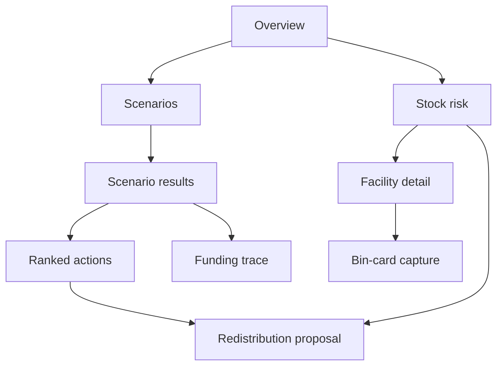

# Roles, information architecture, and flows

## Roles and top jobs

| Role | Top job | Decision supported | Access boundary |
|---|---|---|---|
| County planner | Rehearse a funding or logistics shock | Which mitigation fits the ceiling and where to act first | County aggregate, scenario runs, funding trace |
| District pharmacist | Resolve a likely shortage | Which facility can receive a safe redistribution | District and assigned facilities, transfer proposals |
| Facility in-charge | Reconcile paper stock records | Confirm extracted bin-card fields and report discrepancies | Own facility capture and stock entries |

These are workflow assumptions for design review. Final role permissions belong to backend authorization policy.

## Navigation

Primary destinations: **Overview**, **Scenarios**, **Actions**, **Stock**, **Funding**. **Capture** is a prominent task action from Stock, not a sixth mobile navigation item. Utility destinations: demo, help, language, theme, account. Detail pages keep a visible back path and breadcrumb on wide screens.

## Core flows

1. **Run scenario:** Overview “Run a scenario” → choose shock template → adjust size and time window → set budget ceiling → review synthetic assumptions → “Run stress test” → progress → results. No automatic run from slider movement; slider previews parameters and updates the map only when a completed result exists for those parameters. Preserve the previous result while a new run is pending, visibly marked “Previous run.”
2. **Review bottlenecks:** Results “See funding trace” → stage diagram → filter by ageing and facility → select a bottleneck → inspect related cash release, procurement, and delivery stages. Missing graph data shows a partial-data notice and the Postgres-backed summary when available.
3. **Rank mitigations:** Results “View actions” → budget ceiling control → optimizer returns ordered actions, selected set, cut line, and in/out reasons → inspect an action → prepare a proposal. Changing the ceiling triggers a new optimizer run; never reorder client-side or from LLM text.
4. **Capture bin card:** Stock → facility → “Capture bin card” → camera/file choice → local preview → extract → compare photo and fields → human corrects and confirms → save. Offline captures queue locally with a visible pending count; reconnection syncs only after confirmation and prevents duplicate save.
5. **Act on redistribution:** Stock risk → eligible match → check quantity, expiry, distance, availability, and receiving need → “Prepare transfer” → review confirmation → submit proposal → show undo when the backend can safely reverse it. The interface never claims a physical transfer occurred.

## Three-minute demo

Overview “Try the 3-minute demo” → prefilled “Logistics support drops 40%” synthetic scenario → run → results summary with first stockout sequence → ranked action list and budget cut line → inspect one action rationale. A persistent step indicator shows 1/3, 2/3, 3/3. Exit returns to Overview without saving a plan.
